<!-- Cyber Nihilism · GitHub profile. The panel is generated by scripts/build.py from scripts/config.json. -->

<picture>
  <source media="(prefers-color-scheme: dark)" srcset="assets/profile-signal.svg">
  <source media="(prefers-color-scheme: light)" srcset="assets/profile-print.svg">
  
</picture>
